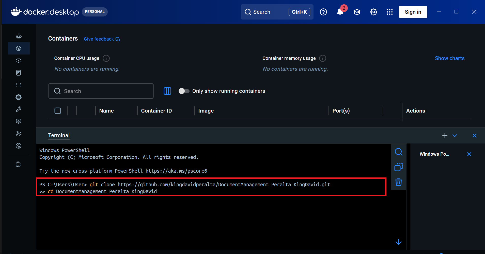
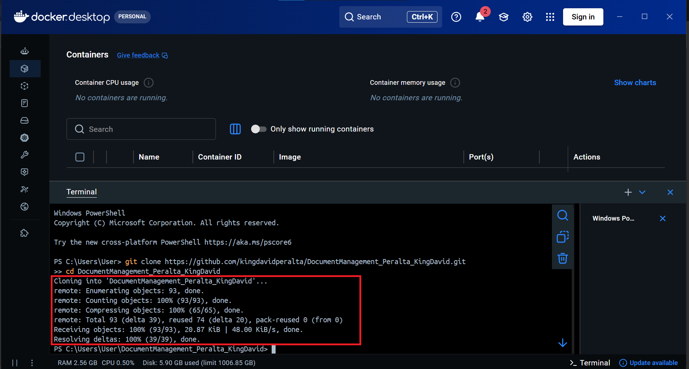
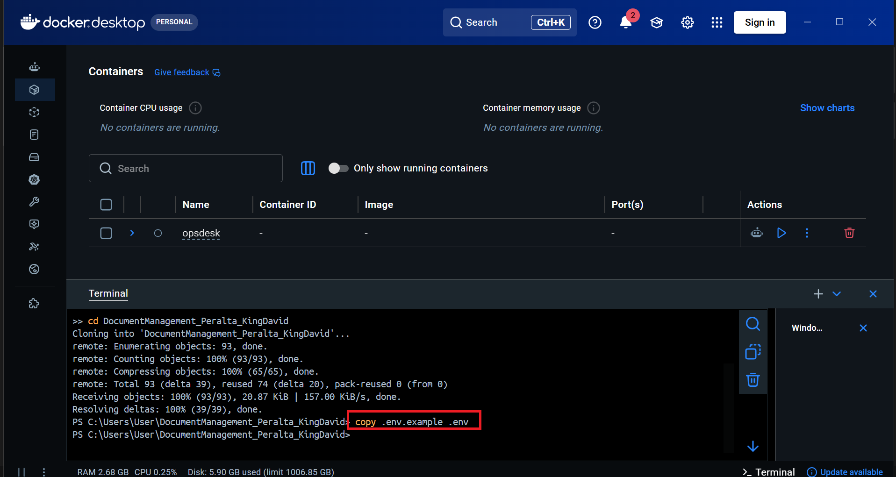
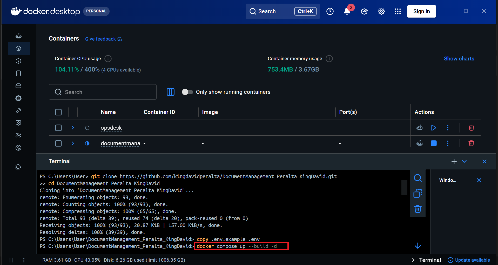
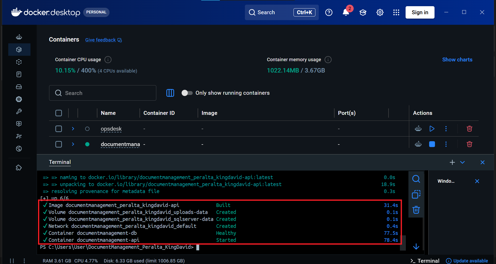
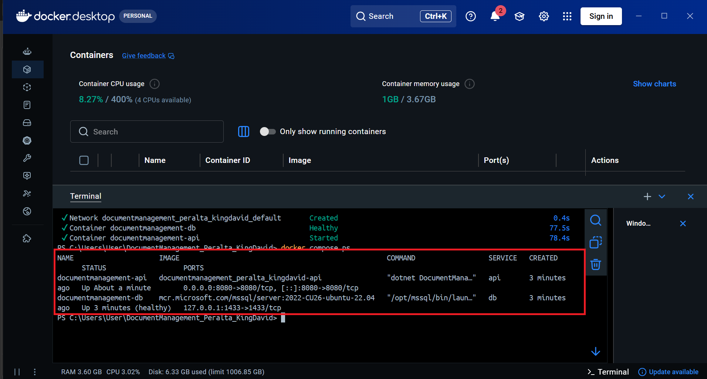
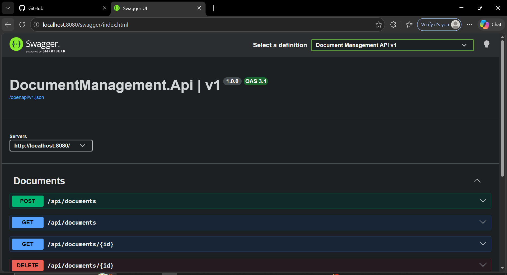
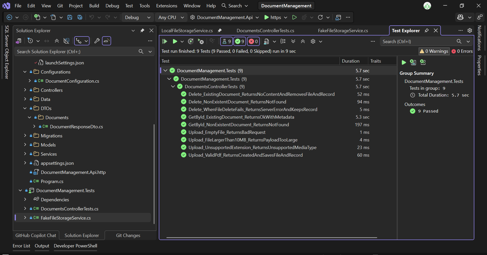

# DocumentManagement_Peralta_KingDavid

A RESTful API for a simple Document Management System, built as a backend technical assessment.
Clients can upload documents, list them, view their details, download them and delete them.

Document **metadata** is stored in a SQL Server database. The **file contents** are stored on disk,
never in the database.

## Overview

| Feature | Endpoint |
|---|---|
| Upload a document | `POST /api/documents` |
| List documents | `GET /api/documents` |
| Get document details | `GET /api/documents/{id}` |
| Download a document | `GET /api/documents/{id}/download` |
| Delete a document | `DELETE /api/documents/{id}` |

## Tech stack

| Area | Choice |
|---|---|
| Language | C# |
| Framework | ASP.NET Core Web API (.NET 10), controller-based |
| Database | Microsoft SQL Server 2022 |
| Data access | Entity Framework Core 10 (code-first, migrations) |
| File storage | Local disk, behind an `IFileStorageService` interface |
| API documentation | OpenAPI document with Swagger UI |
| Containers | Docker and Docker Compose |
| Tests | xUnit |

## Project structure

```
DocumentManagement_Peralta_KingDavid/
├── DocumentManagement.Api/
│   ├── Configurations/     EF Core entity configuration
│   ├── Controllers/        DocumentsController
│   ├── Data/               ApplicationDbContext
│   ├── DTOs/Documents/     Response DTO (never exposes the stored file name)
│   ├── Migrations/         EF Core migrations
│   ├── Models/             Document entity
│   ├── Services/           File storage service
│   └── Program.cs
├── DocumentManagement.Tests/
├── images/                 Screenshots used in this README
├── Dockerfile
├── docker-compose.yml
├── .dockerignore
├── .env.example
└── README.md
```

## How to Run - Getting started (Docker, recommended)

The easiest way to run the project is with Docker. One command starts both SQL Server and the API,
and the database is created automatically. You do not need to install .NET, SQL Server or SSMS.

### Prerequisites

| Tool | Notes |
|---|---|
| [Git](https://git-scm.com/downloads) | To clone the repository |
| [Docker Desktop](https://www.docker.com/products/docker-desktop/) | Must be **running** before you start (Windows, macOS or Linux) |
| Free ports **1433** and **8080** | 1433 is SQL Server, 8080 is the API |

### 1. Clone the repository

Open a terminal (PowerShell, Command Prompt or Terminal) in any folder where you want to keep the project,
for example your Documents folder. Then run:

```bash
git clone https://github.com/kingdavidperalta/DocumentManagement_Peralta_KingDavid.git
cd DocumentManagement_Peralta_KingDavid
```

This creates a folder named `DocumentManagement_Peralta_KingDavid` and moves you into it.
Run all the remaining commands from inside this folder.





### 2. Create your `.env` file

The SQL Server password is not stored in the repository. Create your own `.env` file from the template.

Windows (PowerShell or Command Prompt):

```powershell
copy .env.example .env
```

macOS / Linux:

```bash
cp .env.example .env
```



The template already contains a password that works, so you can continue without editing it.
If you prefer your own, open `.env` and change the value after `SA_PASSWORD=`.

The password must have at least 8 characters, with upper case, lower case, a number and a symbol.
Avoid `;`, `$`, `#`, quotes and spaces, because they break the connection string and the `.env` file.

### 3. Start the application

```bash
docker compose up --build -d
```

The first run downloads the SQL Server image (about 2 GB) and builds the API, so it can take a few minutes.





### 4. Wait until it is ready

```bash
docker compose ps
```

Wait until `documentmanagement-db` shows `healthy` and `documentmanagement-api` shows `running`.
SQL Server needs about 30 seconds to start the first time.



### 5. Try the API

Open Swagger UI in your browser:

**http://localhost:8080/swagger**



Or use the command line:

```bash
curl http://localhost:8080/api/documents
```

An empty list (`[]`) means the API and the database are working.

### Stopping and resetting

| Goal | Command |
|---|---|
| Stop and remove the containers (data is kept) | `docker compose down` |
| Stop and delete **all** data (database and uploaded files) | `docker compose down -v` |
| View the API logs | `docker compose logs api` |

### Troubleshooting

| Problem | Cause and fix |
|---|---|
| `port is already allocated` | Another program is using port 1433 or 8080. Stop it, or change the port on the left side of the `ports` entry in `docker-compose.yml`. |
| The API cannot log in to SQL Server after you edited `.env` | SQL Server stores the password in its volume the first time it starts. Run `docker compose down -v`, then start again. |
| The database container stays unhealthy or exits | Usually a password that does not meet the rules above, or a missing `.env`. Check `docker compose logs db`. |
| Very slow startup on Apple Silicon | The SQL Server image runs under emulation (`linux/amd64`). Allow extra time. |

## Running the automated tests

The tests use xUnit. They do **not** need Docker, SQL Server or any running containers:

- The database is replaced by the EF Core **in-memory provider**.
- File storage is replaced by `FakeFileStorageService`, which keeps files in memory and never touches the disk.

### Prerequisites

- [.NET 10 SDK](https://dotnet.microsoft.com/download/dotnet/10.0)

Check your version with `dotnet --version` (it should start with `10.`).

### Run from the command line

From the repository root:

```bash
dotnet test
```

A successful run ends with a summary like `Passed! - Failed: 0, Passed: 9`.

### Run from Visual Studio

1. Open `DocumentManagement.slnx`.
2. Choose **Test > Run All Tests**.
3. Open **Test > Test Explorer** to see the results.



### What the tests cover

The tests are in `DocumentManagement.Tests/DocumentsControllerTests.cs`.

| Test | Scenario | Required by the assessment |
|---|---|---|
| `Upload_ValidPdf_ReturnsCreatedAndSavesFileAndRecord` | Successful upload | Yes |
| `GetById_ExistingDocument_ReturnsOkWithMetadata` | Retrieve an existing document | Yes |
| `GetById_NonExistentDocument_ReturnsNotFound` | Nonexistent document returns 404 | Yes |
| `Upload_FileLargerThan10MB_ReturnsPayloadTooLarge` | Upload over 10 MB is rejected with 413, nothing is saved | Yes |
| `Delete_ExistingDocument_ReturnsNoContentAndRemovesFileAndRecord` | Delete removes the record and the file | Yes |
| `Upload_EmptyFile_ReturnsBadRequest` | Empty file is rejected with 400 | Extra |
| `Upload_UnsupportedExtension_ReturnsUnsupportedMediaType` | Unsupported file type is rejected with 415 | Extra |
| `Delete_NonExistentDocument_ReturnsNotFound` | Deleting an unknown id returns 404 | Extra |
| `Delete_WhenFileDeleteFails_ReturnsServerErrorAndKeepsRecord` | A disk error during delete returns 500 and keeps the database record | Extra |
